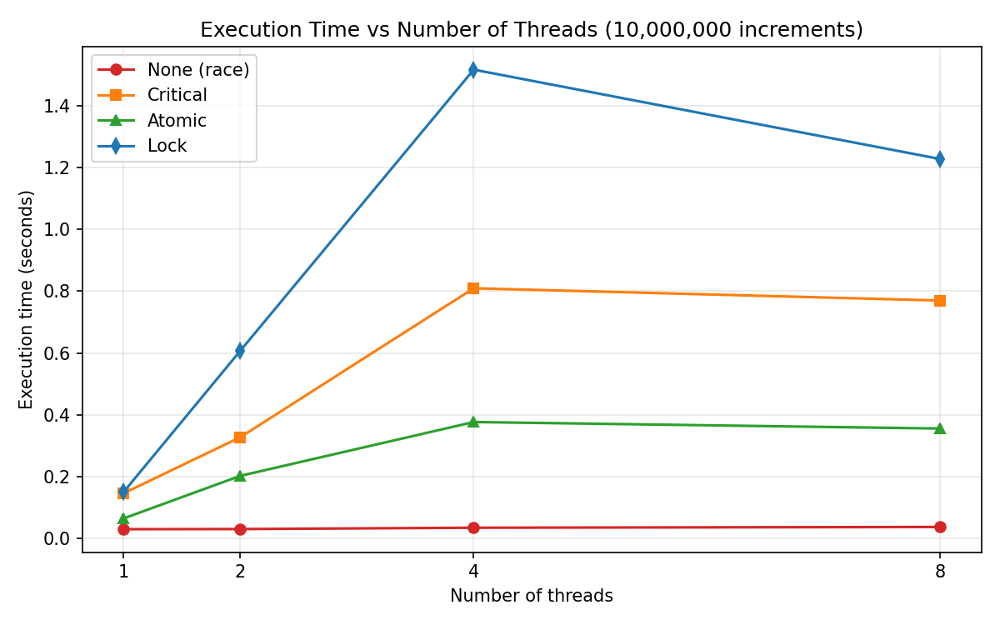
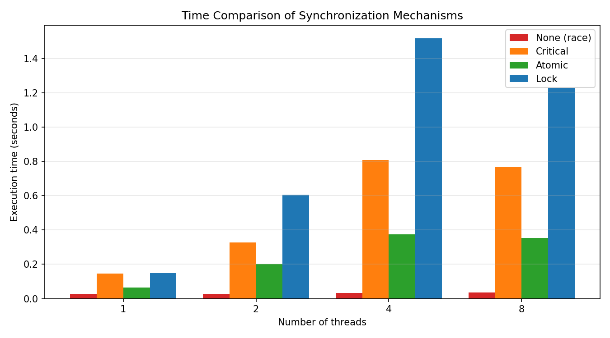
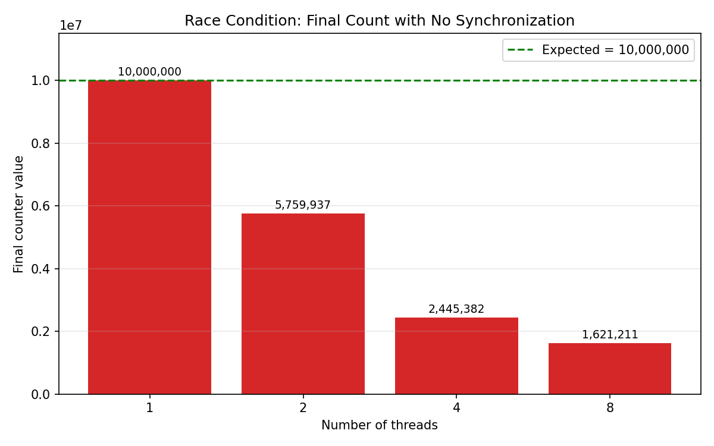
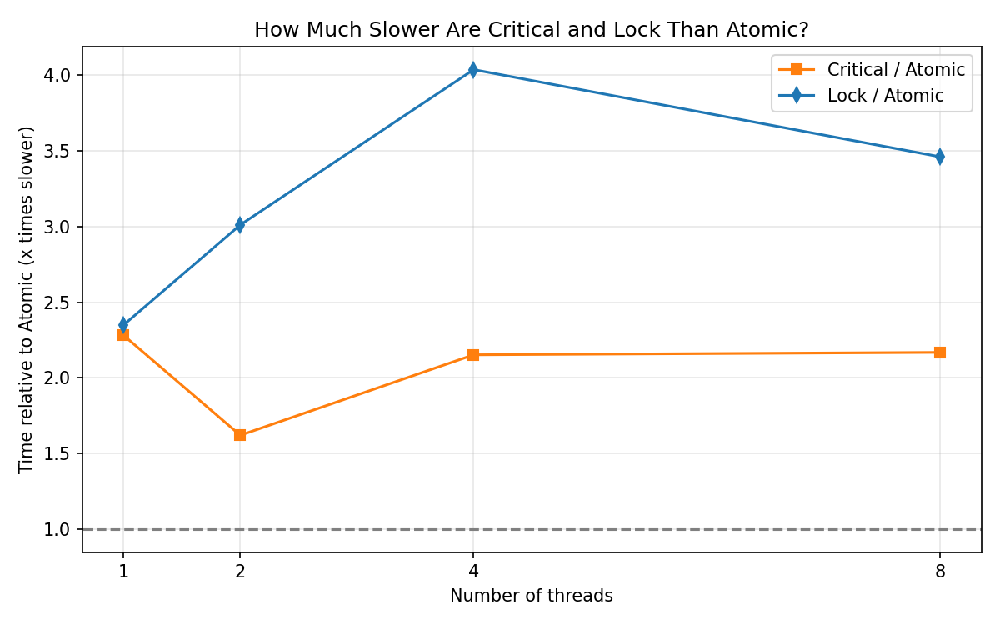

# Analyzing Synchronization Mechanisms in Parallel Programs


-purple)

A hands-on study of how multiple threads can safely update shared data. Six C programs compare an **unsynchronized (race) update**, **critical sections**, **atomic operations**, **locks**, **barriers** and **semaphores**, and measure each one for **correctness**, **execution time** and **scalability** as the number of threads grows.

---

## Table of Contents

1. [Objective](#1-objective)
2. [Key Concepts in Simple Words](#2-key-concepts-in-simple-words)
3. [Environment](#3-environment)
4. [Repository Structure](#4-repository-structure)
5. [Setup](#5-setup)
6. [Programs](#6-programs)
7. [How to Compile and Run](#7-how-to-compile-and-run)
8. [Results and Output Screenshots](#8-results-and-output-screenshots)
9. [Graphs](#9-graphs)
10. [Analysis](#10-analysis)
11. [Observation Table](#11-observation-table)
12. [Conclusion](#12-conclusion)
13. [Key Learnings](#13-key-learnings)
14. [Author](#14-author)

---

## 1. Objective

To implement and study the common synchronization mechanisms used in shared-memory parallel programs, and to evaluate their:

- **Correctness**: does the program always produce the right answer?
- **Performance**: how fast does it run?
- **Scalability**: what happens to the run time as more threads are added?

---

## 2. Key Concepts in Simple Words

Imagine several friends (**threads**) who each have to add 1 to a number written on a shared whiteboard (the **counter**).

To add 1, a friend must: **read** the number, **add 1**, then **write** it back. If two friends read the same number at the same moment, both write the same result and **one update is lost**. This is a **race condition**.

**Synchronization** means making the threads coordinate so that the shared data stays correct.

| Mechanism | Whiteboard analogy | Directive / API |
|---|---|---|
| **No synchronization (race)** | Everyone rushes to the board at once | none |
| **Critical section** | Only one friend at the board at a time, others queue | `#pragma omp critical` |
| **Atomic operation** | A special "+1 button" that works in one indivisible step | `#pragma omp atomic` |
| **Lock** | One marker; whoever holds it may write | `omp_set_lock` / `omp_unset_lock` |
| **Barrier** | Nobody starts part 2 until everyone has finished part 1 | `#pragma omp barrier` |
| **Semaphore** | A single key to the room; take it to enter, return it when leaving | `sem_wait` / `sem_post` |

---

## 3. Environment

| Item | Details |
|---|---|
| Virtualization | VMware Workstation |
| Guest OS | Ubuntu (64-bit) |
| Compiler | GCC 15.2.0 |
| Parallel libraries | OpenMP (`libgomp`, bundled with GCC), POSIX Threads (`pthread`) and `semaphore.h` |
| CPU cores in the VM | 4 (checked with `nproc`) |

---

## 4. Repository Structure

```
Synchronization_Mechanisms-PGC/
├── README.md
├── race.c              # Program 1: race condition (no synchronization)
├── critical.c          # Program 2: critical section
├── atomic.c            # Program 3: atomic operation
├── barrier.c           # Program 4: barrier
├── semaphore.c         # Program 5: semaphore
├── compare_sync.c      # Program 6: benchmark of all mechanisms
├── screenshot/         # Terminal output of every program
│   ├── 1_race.jpeg
│   ├── 2_critical.png
│   ├── 3_atomic.png
│   ├── 4_barrier.png
│   ├── 5_semaphore.png
│   └── 6_compare_sync.png
└── graph/              # Graphs generated from the benchmark results
    ├── graph1_time_vs_threads.png
    ├── graph2_time_bar_comparison.png
    ├── graph3_race_correctness.png
    └── graph4_slowdown_vs_atomic.png
```

---

## 5. Setup

Install the compiler and verify OpenMP support:

```bash
sudo apt update
sudo apt install build-essential git -y
gcc --version
echo '#include <omp.h>' | gcc -E -fopenmp -xc - > /dev/null && echo OpenMP OK
nproc    # number of CPU cores available
```

> Use at least 4 cores in the VM; with fewer cores the scalability differences are hard to observe.

---

## 6. Programs

Each of Programs 1 to 3 and 5 increments a shared counter; Program 4 synchronizes thread phases; Program 6 benchmarks everything.

| # | File | Mechanism | Workload | Expected result |
|---|---|---|---|---|
| 1 | `race.c` | None (race condition) | 10,000,000 increments | Wrong, different every run |
| 2 | `critical.c` | `omp critical` | 10,000,000 increments | `Counter=10000000` (slow) |
| 3 | `atomic.c` | `omp atomic` | 10,000,000 increments | `Counter=10000000` (faster) |
| 4 | `barrier.c` | `omp barrier` | Each thread prints before/after | All "before" lines precede all "after" lines |
| 5 | `semaphore.c` | Binary semaphore (pthreads) | 2 threads x 100,000 increments | `Counter=200000` |
| 6 | `compare_sync.c` | None, Critical, Atomic, Lock | 10,000,000 increments at 1, 2, 4, 8 threads | Correctness and timing table |

---

## 7. How to Compile and Run

> Do **not** use `-O2`/`-O3`: compiler optimization can hide the race condition.

```bash
gcc race.c         -fopenmp -o race
gcc critical.c     -fopenmp -o critical
gcc atomic.c       -fopenmp -o atomic
gcc barrier.c      -fopenmp -o barrier
gcc semaphore.c    -pthread -o semaphore
gcc compare_sync.c -fopenmp -o compare_sync
```

Run (the thread count is set with `OMP_NUM_THREADS`):

```bash
for i in 1 2 3; do OMP_NUM_THREADS=4 ./race; done   # run several times to see different wrong answers
time OMP_NUM_THREADS=4 ./critical
time OMP_NUM_THREADS=4 ./atomic
OMP_NUM_THREADS=4 ./barrier
./semaphore
./compare_sync
```

---

## 8. Results and Output Screenshots

### 8.1 Race condition: no synchronization

Three runs with 4 threads gave three different wrong answers (the correct value is 10,000,000):

| Run | Counter |
|---|---|
| 1 | 3,612,652 |
| 2 | 3,113,303 |
| 3 | 3,775,812 |


### 8.2 Critical section

Correct result, `real` time **0.815 s** with 4 threads.


### 8.3 Atomic operation

Correct result, `real` time **0.352 s** with 4 threads, about 2.3x faster than critical.


### 8.4 Barrier

All four "before barrier" lines are printed before any "after barrier" line, which proves that no thread passed the barrier until every thread had reached it.


### 8.5 Semaphore

Two threads x 100,000 increments gave the correct `Counter=200000`.


### 8.6 Comparison benchmark


| Mechanism | Threads | Final Count | Correctness | Time (s) |
|---|---|---|---|---|
| None | 1 | 10000000 | Correct | 0.0287 |
| Critical | 1 | 10000000 | Correct | 0.1451 |
| Atomic | 1 | 10000000 | Correct | 0.0636 |
| Lock | 1 | 10000000 | Correct | 0.1495 |
| None | 2 | 5759937 | **INCORRECT** | 0.0291 |
| Critical | 2 | 10000000 | Correct | 0.3268 |
| Atomic | 2 | 10000000 | Correct | 0.2016 |
| Lock | 2 | 10000000 | Correct | 0.6072 |
| None | 4 | 2445382 | **INCORRECT** | 0.0334 |
| Critical | 4 | 10000000 | Correct | 0.8096 |
| Atomic | 4 | 10000000 | Correct | 0.3760 |
| Lock | 4 | 10000000 | Correct | 1.5182 |
| None | 8 | 1621211 | **INCORRECT** | 0.0358 |
| Critical | 8 | 10000000 | Correct | 0.7698 |
| Atomic | 8 | 10000000 | Correct | 0.3549 |
| Lock | 8 | 10000000 | Correct | 1.2284 |

> Exact timings vary from machine to machine and from run to run; the pattern is what matters.

---

## 9. Graphs

### Execution time vs number of threads


### Time comparison at each thread count


### Race condition: final count vs expected


### How much slower are Critical and Lock than Atomic?


The graphs were generated with Python (matplotlib) from the benchmark table above.

---

## 10. Analysis

**Correctness.** Without synchronization, the result is wrong as soon as more than one thread is used, and it gets worse with more threads: about 42% of the updates were lost with 2 threads, about 76% with 4 threads and about 84% with 8 threads. Critical, Atomic and Lock produced the correct 10,000,000 in every run.

**Performance.** The unsynchronized version is the fastest (about 0.03 s) but its answer is useless. Among the correct methods, Atomic is the fastest, because it uses a lightweight hardware instruction. Critical and Lock make threads wait in line for the same lock, so they are slower. With 4 threads, Critical took about 2.2x and Lock about 4x as long as Atomic.

**Scalability.** None of the protected methods got faster with more threads; their times went up compared with a single thread. Every thread needs the same shared variable, so adding threads adds waiting and cache contention instead of useful parallel work. The times for 4 and 8 threads are similar because the VM has only 4 cores, so 8 threads cannot truly run at the same time.

**Barrier and semaphore.** A barrier does not protect data; it only keeps the phases of a computation in order, with a waiting cost equal to the time of the slowest thread. A binary semaphore (initial value 1) behaves like a mutex and gave the correct count of 200,000.

---

## 11. Observation Table

| Mechanism | Correctness | Relative Performance | Scalability |
|---|---|---|---|
| None (race condition) | Incorrect | Fastest (no overhead) | Poor: the wrong result gets worse with more threads |
| Critical section | Correct | Slow (serializes all threads) | Poor: contention grows with thread count |
| Atomic operation | Correct | Fastest of the correct methods | Better than Critical and Lock, but still slower than 1 thread |
| Lock (`omp_lock_t`) | Correct | Slowest in these runs | Poor |
| Barrier | Synchronization only | Waiting overhead | Limited by the slowest thread |
| Semaphore | Correct | Moderate (system-call overhead) | Moderate |

---

## 12. Conclusion

Atomic operations give the best balance of correctness and speed for simple shared-variable updates such as `counter++`, because they rely on lightweight hardware instructions. Critical sections and locks guarantee correctness but limit scalability, since threads must take turns. Barriers do not protect data; they keep the phases of a parallel computation in step. Semaphores generalize mutual exclusion (a counting semaphore can admit N threads at once) at a moderate overhead. The experiment confirms the central trade-off: unsynchronized access is fastest but unreliable, and the choice among critical, atomic, lock and semaphore is a balance between strength of guarantee, overhead and scalability.

---

## 13. Key Learnings

- `counter++` is **not** one step (read, add, write), which is why races lose updates.
- A program that runs fast but gives the wrong answer is not a fast program.
- Use **atomic** for a simple update to one variable, and **critical** or a **lock** when you must protect a larger block of code.
- Adding threads does not automatically make a program faster; shared data can become a bottleneck.
- Always check results for correctness and not just for speed.

---

## 14. Author

**Name:** Ishani Goudar
**Course:** Parallel Computing
**Experiment:** Analyze Synchronization Mechanisms in Parallel Programs
